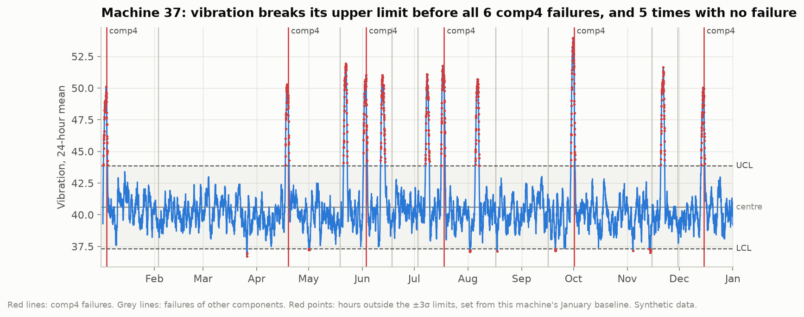
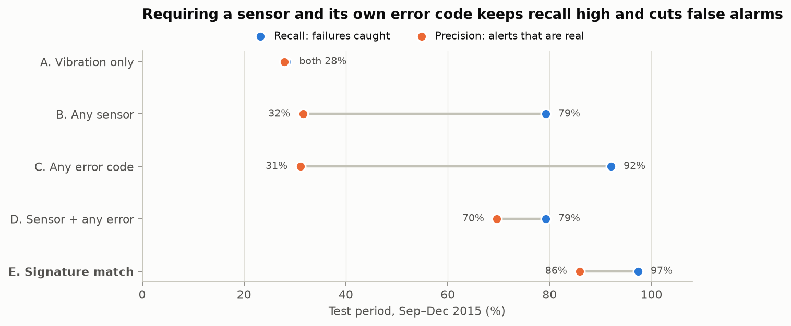
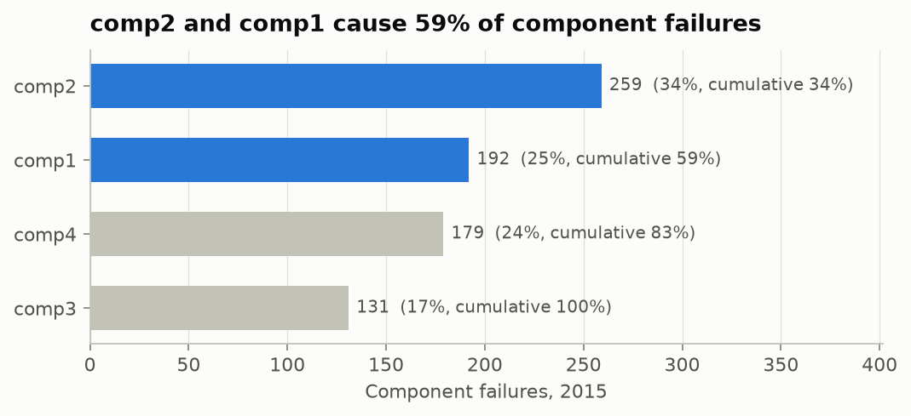
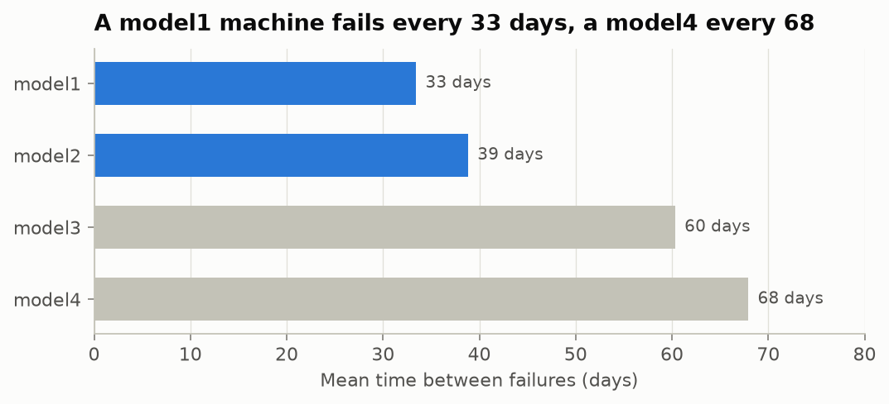
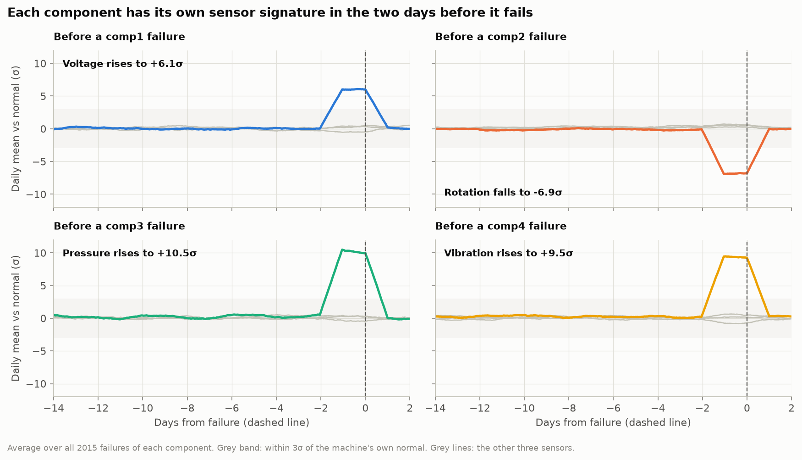
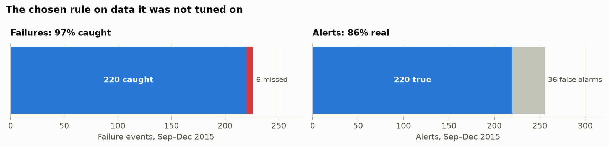

# Cutting unplanned downtime on a machine fleet

**Where do unplanned failures cost us most, do the machines warn us before they fail, and would replacing parts based on those warnings pay off?**

An analysis of one year of failures, error codes, maintenance records and 876,100 hourly sensor readings from 100 machines. It is written for a plant maintenance manager setting next year's budget. The pipeline uses PostgreSQL for loading, data-quality checks and the failure analysis, Python for control charts and alert-rule testing, and Excel for the business case.

- 📄 **[One-page summary for the maintenance manager (PDF)](docs/executive_summary.pdf)**
- 📊 **[Excel business case](excel/PdM_business_case.xlsx)**: inputs, cost model, Power Query, sensitivity Data Table, Scenario Manager
- 📓 **[Self-contained notebook](https://www.kaggle.com/code/jakubsiuda/cutting-unplanned-downtime-on-a-machine-fleet)** (runs in the browser on the raw Kaggle files)

> **The data is synthetic** ([Microsoft Azure Predictive Maintenance](https://www.kaggle.com/datasets/arnabbiswas1/microsoft-azure-predictive-maintenance)). The findings show what this method would reveal on real plant data, not facts about a real plant. Every cost in the business case is a labelled assumption.



## Key findings

1. **Failures concentrate in two components and two machine models.** comp2 and comp1 account for 59% of the 761 failed parts. model1 and model2 machines are a third of the fleet but cause 47% of the 719 stoppages: one every 33–39 days per machine, against 60–68 days for model3 and model4. comp3 fails only on model1 and model2. Older machines fail more often too (about 0.26 more failures a year per year of age, r = 0.46), and this holds within every model, so age and model are separate effects.
2. **The machines warn about a day ahead, and a rule needs two signals to use that warning well.** Before each component fails, one sensor moves away from that machine's normal level: voltage before comp1, rotation before comp2, pressure before comp3, vibration before comp4. The matching error code appears too. A rule that fires when a sensor leaves its control limit **and** its own error code appeared in the last 24 hours was chosen on January–August data. On September–December data it had never seen, it **caught 220 of 226 failures (97%)**, **220 of its 256 alerts were real (86%)**, and it gave about 19 hours of notice. Single signals do much worse: the brief's example rule (vibration above its limit for 6 hours) caught 28% of failures, and "any error code" caught 92% but only 31% of its alerts were real.
3. **Acting on the alerts pays off unless the rule works much worse on real data.** In the base case (8-hour breakdowns, 3,000 PLN per hour of downtime), annual maintenance cost falls from 34.8 to 23.0 million PLN, a **saving of 11.8 million PLN (34%)**. Almost all of it comes from turning breakdowns into short planned stops. Across the three scenarios the saving ranges from **−0.4 to +65.3 million PLN** a year. The base case still pays if only 8% of alerts are real. The cautious case (60% real alerts, short and cheap stops) loses money, because it needs 81%.



## Recommendation

- **Pilot the two-signal alert on the model1 and model2 machines first.** They have the most failures and are the only ones where comp3 fails.
- **Track precision from the first month.** The business case turns on it. If fewer than about 80% of alerts find a real problem while stops stay short, the cautious case applies and the alerts cost more than they save.
- **Start logging repair times and downtime per stop.** This dataset has neither, so downtime is assumed. Three months of real records would replace the biggest assumption in the model.
- **Keep the preventive schedule during the pilot.** Stretch replacement intervals (the optimistic case) only once the alerts have proved themselves on real data.

## Data

| Table | Rows | Contents |
| --- | ---: | --- |
| machines | 100 | Model (model1–4) and age (0–20 years) |
| telemetry | 876,100 | Hourly voltage, rotation, pressure and vibration, 1 Jan 2015 06:00 to 1 Jan 2016 06:00 |
| errors | 3,919 | Non-breaking error codes (error1–5) |
| maint | 3,286 | Component replacements (comp1–4), June 2014 to January 2016 |
| failures | 761 | Component failures, 2015 |

All 12 must-pass data-quality checks pass: row counts, a reading for every machine-hour with no gaps, no readings at or below zero, and every event inside the telemetry period. The full log, with the facts that shaped the analysis, is in [`docs/02_data_quality_log.md`](docs/02_data_quality_log.md).

## Method

```
Kaggle CSVs ──► src/load_db.py ──► PostgreSQL: 5 tables + sql/02 clean views + sql/03 data-quality checks
                                          │
                                   sql/04–06 analysis views ──► src/export_views.py ──► data/exports/*.csv
                                          │
             notebooks/01 EDA ──► 02 control charts ──► 03 alert rules ──► data/exports/alert_*.csv
                                          │
                     excel/PdM_business_case.xlsx (Power Query) ──► docs/executive_summary.pdf
```

- **Q1 – where do failures concentrate?** `sql/04_pareto.sql`: Pareto of failures by component, model and age group; failures per machine; a model × age cross-tab to separate the two effects.
- **Q2 – how reliable is each group?** `sql/05_mtbf.sql`: MTBF as operating hours ÷ failures by model, component and model × component, cross-checked against the median gap between failures (`LAG`); correlation of age with failures, overall and within each model.
- **Q3 – do failures give warning?** `sql/06_error_windows.sql`: how often each error code appears in the 24 and 48 hours before a failure compared with the rest of the time. [`notebooks/01_eda.ipynb`](notebooks/01_eda.ipynb) and [`02_control_charts.ipynb`](notebooks/02_control_charts.ipynb): each sensor's 24-hour mean against limits set from each machine's own January baseline.
- **Q4 – how good would an alert be?** [`notebooks/03_alert_evaluation.ipynb`](notebooks/03_alert_evaluation.ipynb): five rule families at several thresholds, chosen on January–August and scored on September–December for recall, precision and lead time, overall and per component.
- **Q5 – is it worth it?** [`excel/PdM_business_case.xlsx`](excel/PdM_business_case.xlsx): today's cost (repairs after failure plus scheduled replacements) against the cost with alert-triggered inspections, in cautious, base and optimistic scenarios, with a sensitivity table of saving by downtime cost and recall.

### Decisions worth knowing

- **Failed parts vs stoppages.** Two components fail together in 42 events, so 761 failed parts are 719 stoppages. Component charts count parts; models, machines, MTBF and alert recall count stoppages.
- **Control limits per machine, from its own January.** Each machine is compared with its own normal, from the first 30 days minus the 7 days before and 2 days after any failure. The limits use the standard deviation of the 24-hour means, not the textbook moving range: consecutive rolling means share 23 of 24 readings, so their moving range would make the limits far too tight.
- **Alert rules.** Repeat firings within 7 days count as one alert (one inspection). No alerts in the 48 hours after a part replacement, while the 24-hour mean still includes readings from before the repair. An alert is true if a failure follows within 7 days.
- **No peeking at the test period.** The sensor and error code for each component, the thresholds and the final rule were all chosen on January–August. The selection rule was set in advance: the highest precision among rules that catch at least 90% of failures.
- **Break-even precision rather than break-even downtime cost.** In the base case the alerts save money even if downtime cost nothing (no rush premium on parts, shorter repairs), so a break-even cost per hour would be 0 and say nothing. Inspection cost is the one cost that grows as alerts get less precise, so the model reports the lowest share of real alerts at which the alerts still pay.
- **The Data Table lives on the Inputs sheet.** Excel requires a Data Table's input cells to be on the same sheet as the table; the Sensitivity sheet displays its results.

### Limitations

- **Synthetic data, and it shows.** The warning signs are far cleaner than a real plant's, 604 of 621 gaps between failures are exact multiples of 15 days, and 196 of 220 caught failures got exactly 19 hours of notice. Expect lower recall and precision on real data; the cautious scenario is there for that.
- **No downtime, repair-time or cost data.** Downtime hours, cost per hour, part prices and labour times are assumptions on the Inputs sheet. Only the technician labour rate (80 PLN/hour) is anchored to published pay data.
- **Failures are logged once a day (06:00),** so lead times are accurate to about a day.
- **18 failures have no matching repair record,** all at the same timestamp (2 Jan 2015, 03:00); they are kept as failures.
- **One year, 100 machines.** Group comparisons with few machines (for example model × age cells of 2–11 machines) are directional.

## How to reproduce

**Quickest: one notebook, no database.** [`notebooks/kaggle_predictive_maintenance.ipynb`](notebooks/kaggle_predictive_maintenance.ipynb) runs the core analysis straight from the five CSVs, on Kaggle or locally.

**Full pipeline.** Needs Python 3.10+ and PostgreSQL 13+ (built and tested on PostgreSQL 16).

```bash
python -m venv .venv && .venv\Scripts\activate   # Windows; on macOS/Linux: source .venv/bin/activate
pip install -r requirements.txt

# download the five CSVs from Kaggle into data/raw/, then:
python src/load_db.py      # creates the database, loads the tables, builds the views, runs the checks
python src/export_views.py # writes the analysis views to data/exports/*.csv for Excel and the notebooks

# then run the notebooks in order (Run All): 01_eda, 02_control_charts, 03_alert_evaluation
# they read data/raw/ and data/exports/, write charts to images/ and alert results to data/exports/alert_*.csv
```

`load_db.py` reads the standard `PGHOST`/`PGPORT`/`PGUSER` variables and asks for the password, which is never written to disk. It loads the 876,100 telemetry rows with `COPY` in about 15 seconds and writes the data-quality results to [`docs/02_data_quality_log.md`](docs/02_data_quality_log.md). After editing any SQL file, `python src/load_db.py --views-only` rebuilds the views without reloading the data.

The Excel workbook loads `data/exports/` through Power Query: after re-running the pipeline, open it and use **Data → Refresh All**.

## Repository

| Path | Contents |
| --- | --- |
| `sql/` | `01` tables · `02` clean views · `03` data-quality checks · `04` Pareto · `05` MTBF · `06` error windows |
| `src/` | `load_db.py` (load and check) · `export_views.py` (CSV exports) · `pdm.py` (shared notebook helpers) |
| `notebooks/` | `01_eda` · `02_control_charts` · `03_alert_evaluation` · `kaggle_predictive_maintenance` (all-in-one) |
| `excel/` | `PdM_business_case.xlsx` |
| `data/exports/` | Small CSVs from SQL and the alert evaluation, read by Excel and the notebooks |
| `data/raw/` | The five Kaggle CSVs (not committed) |
| `docs/` | Problem statement, data-quality log, SQL findings, one-page summary |
| `images/` | Every chart in this README and the notebooks |

## Charts

| | |
| --- | --- |
|  |  |
| **Q1:** two components cause 59% of failed parts | **Q2:** model1 fails twice as often as model4 |
|  |  |
| **Q3:** each component has its own sensor signature | **Q4:** the chosen rule on data it was not tuned on |
